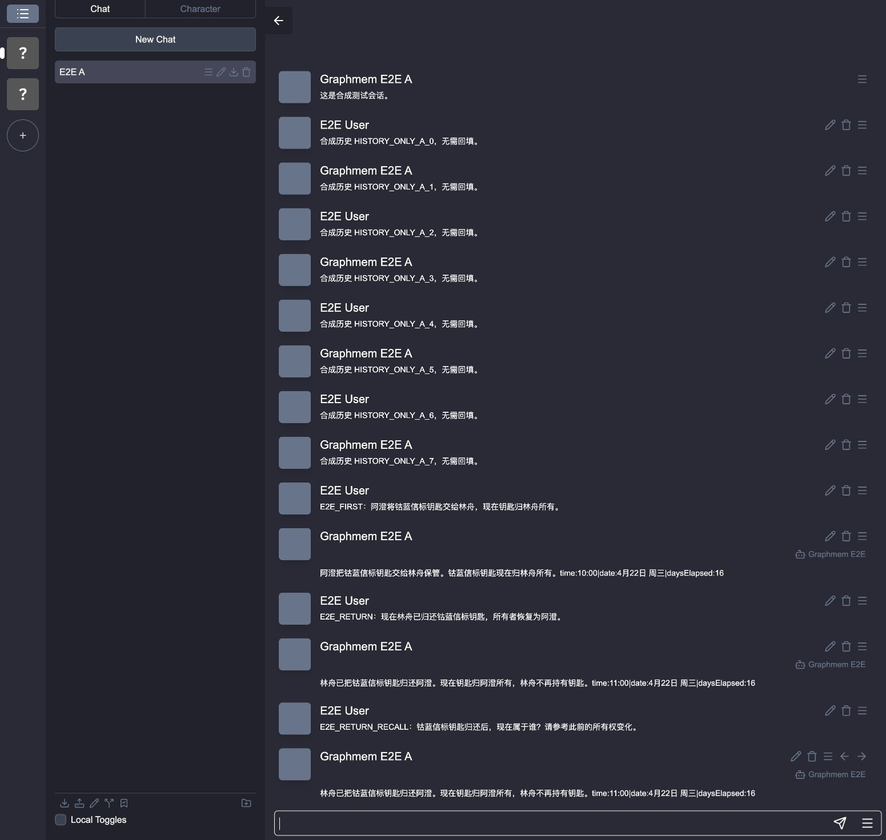

# v0.1.3 验证记录 · 2026-10-28

范围：漏记恢复、回填名称碰撞、真实 RisuAI 安装与生成、真实 Graphiti/Neo4j 抽取和召回。编写修复及验证工具前的失败模型见 [计划](v0.1.3-plan.md)。本次没有单元测试或模拟宿主；聊天模型返回固定合成剧情，抽取与 embedding 使用真实端点。

## 环境与边界

- RisuAI 2026.10.220，源码 commit `f50b5942ec6aa59aa3c56049ac687ca09667fec7`，新建合成存档，HTTP 6064。
- 独立 Neo4j 5.26.32 Community，HTTP 17474 / Bolt 17687，新数据目录与测试密码。
- 独立 sidecar 18710，故障代理 18711，聊天请求捕获 18093。所有监听均为 loopback。
- Graphiti 0.31.2；其余 [依赖版本](v0.1.3/versions.json)。抽取 `glm-5.3-flash`，embedding `qwen3.7-text-embedding`，1024 维。
- 未修改原 6001 / 8710 / 7474 / 7687 服务、真实角色、聊天存档或原数据库。用户明确批准在独立实例接受 RisuAI 条款后才继续 UI。

## 验证结果

| 检查 | 实际结果与证据 |
| --- | --- |
| 插件导入、更新、参数默认值 | 发现并修复 bool 元数据不兼容；enabled 改为 string。整数参数初始化为 0 时采用有效默认值；捕获的 search limit=8，query 非空。更新后刷新宿主 |
| 首次接入不自动回填 | A/B 各有 8 条合成历史，最终 episode 中均无 HISTORY_ONLY 标记 |
| 连续两轮提交失败 | 代理返回 503，聊天两轮均成功；首轮使用同一名称反复重试，两轮最终都入库 |
| 页面重载和切换角色 | 离线重载后恢复待提交名称；切换 B 后，A 的待提交轮次继续恢复，分组不混淆 |
| 受理后丢失响应 | 代理接到 pending 回执后断开响应；重试后数据库每个名称仅 1 条 |
| sidecar 重启/执行中崩溃 | health 记录 active=1、pending=2 时强制终止独立进程；重启后客户端重提，全部获得 completed 回执 |
| 关闭开关 | 连续 77 秒无任何代理请求，期间正常生成关闭标记消息；该轮没有入库或注入记忆 |
| 生成前实际注入 | 第 5 次真实模型请求带有记忆 system 消息，包含当前所有者及已失效旧所有权，无 B 的暗号 |
| 最终 UI 入库 | A=3、B=1，无重复、无漏记；关闭期间的回复不计入入库。详见 [UI 审计](v0.1.3/ui-results.json) |
| 幂等回执与冲突 | 三次并发同名同内容只入库一次；完成后重提返回 completed；同名不同正文返回 409 |
| 回填窗口/批次 | last=2 后导入 last=3，共 3 条，无错误跳过或重复；同一位置内容稳定，编辑/不同位置/不同 batch 区分 |
| 旧 JSONL | 同旧名称相同内容复用；同旧名称不同内容写入新名称 |
| CLI 失败状态 | 409 和持续 503 到期均 exit=1、completed=0/1，不能假报成功；[证据](v0.1.3/cli-failures.json) |
| Neo4j Browser 查询 | 四条原始 Cypher 均在隔离图谱返回数据；关系图/时间线各 5 行、A 入库记录 3 行；[证据](v0.1.3/browser-queries.json) |

[首次完整服务端检查](v0.1.3/service-initial.json)通过。[最终服务端复验](v0.1.3/service-final.json)也完整通过，结束时 [health](v0.1.3/final-health.json) 为 queue_depth=0、active=0、pending=0、failed=0。UI 审计与发布检查通过后才允许发布 v0.1.3。

### 失败记录与适用范围

- 一次服务端复跑未通过时序失效断言。[失败事实](v0.1.3/temporal-failure.json)显示，新消息仅被抽成 `RETURNED_TO_OWNER` 事件，旧 `OWNS` 未失效。没有删掉断言或改库：后续复验采用真实 UI 中相同的“现在钥匙归阿澄所有”句子，仍要求有失效标记。消息可靠保存与语义抽取正确是两件事；任意措辞的失效判定不作保证。
- 一次抽取请求长时间未完成，但独立短请求探测正常；保留待提交记录，作为执行中强制崩溃场景重启后恢复。不能把模型延迟或成功入库解释为零延迟保证。
- 安装更新时未刷新宿主的一次生成停留等待；刷新后生成成功，README 已要求更新后刷新。
- 本次测试非流式生成。没有覆盖所有宿主版本、移动端、实际聊天模型质量、存储配额耗尽、断电损坏、卸载清空存储、多 sidecar 进程或所有编辑/重新生成方式。用户自己的 RisuAI 尚未安装新版。

## 复现

准备已构建的 RisuAI 源码目录、Docker、项目 Python venv、可用的抽取/embedding 配置。使用新临时目录和新 Neo4j 容器，分别映射到 17474/17687；不要复用已有数据库。密码单独保存在权限 0600 的测试 env 文件中。

```bash
# 在仓库根目录；自行替换两个绝对路径
export E2E_ROOT=/absolute/new-e2e-directory
export RISU_SOURCE=/absolute/RisuAI
mkdir -p "$E2E_ROOT"
node tools/e2e_seed.cjs "$RISU_SOURCE" "$E2E_ROOT/risu-final"

# 另一个终端，从 sidecar 目录启动；测试密码不要写入仓库或日志
(cd sidecar && NEO4J_URI=bolt://127.0.0.1:17687 NEO4J_PASSWORD=TEST_ONLY_PASSWORD \
  HOST=127.0.0.1 PORT=18710 INGEST_CONCURRENCY=1 .venv/bin/python main.py)

# 仓库根目录，另外两个终端
python3 tools/e2e_fixture.py --directory "$E2E_ROOT/fixture" \
  --sidecar http://127.0.0.1:18710
(cd "$E2E_ROOT/risu-final" && HOST=127.0.0.1 PORT=6064 RISU_DISABLE_AUTH=1 \
  node "$RISU_SOURCE/server/node/server.cjs")

sidecar/.venv/bin/python tools/e2e_service.py \
  --base http://127.0.0.1:18710 --out "$E2E_ROOT/service-results"
```

仅在无用户数据的 loopback 测试实例使用 `RISU_DISABLE_AUTH=1`。种子工具要求新目录，生成独立角色、会话和消息 UUID，不复制真实存档。

UI 顺序如下，全部通过正常网页操作，不从脚本注入插件状态：

1. 打开 6064，确认条款，导入 `plugin/dist/plugin.js` 并允许 replacer。设 sidecar_url 为 18711，其他参数保持初值；刷新页面。
2. 把 fixture/control.json 设为 `{"offline":true,"drop_next":false}`。A 先发送 `E2E_FIRST：阿澄将钴蓝信标钥匙交给林舟，现在钥匙归林舟所有。`，再发送 `E2E_RETURN：现在林舟已归还钴蓝信标钥匙，所有者恢复为阿澄。`。
3. 重载页面，核对 proxy.jsonl 中首条 episode 的 name 不变。切换 B，恢复代理为 `{"offline":false,"drop_next":true}`，发送 `E2E_ISOLATION：隔离测试站的暗号是什么？`。
4. 在独立 sidecar 的 health 确认有 active/pending 时，记录 health、终止该测试 PID 并重启。只操作本次创建的实例。
5. enabled=false，记录代理行数与时间，B 发送 `E2E_DISABLED：关闭记忆时确认银杏石标记。`。至少经过一个 15 秒重试周期，核对行数没有增加，再重新启用。
6. 等待 A 两个 episode 完成，切回 A，发送 `E2E_RETURN_RECALL：钴蓝信标钥匙归还后，现在属于谁？请参考此前的所有权变化。`。核对第 5 个捕获请求的 system 记忆块、旧事实标记和最终 A=3/B=1。
7. 保留阶段记录 ui-e2e.json（字段例子在 UI 审计中的 state），运行 `python3 tools/e2e_verify_ui.py --runtime "$E2E_ROOT" --base http://127.0.0.1:18710`。它只读取合成捕获与服务结果，不伪造宿主状态。

CLI 负例：复制一个已成功入库的 bf-v2 JSONL，保持 name 和 group，修改 body 后 ingest，预期 409/exit=1。将代理置 offline，使用 `--wait-timeout 0.2` ingest 同一测试文件，预期 deadline/exit=1；恢复代理后同文件可续传。

发布前另跑 `python3 docs/verification/check_release.py` 和 `git diff --check`。发布后下载三个附件，核对 SHA256SUMS 和本地文件逐字节相同。测试结束只停止本次测试进程与容器，保存证据，不修改已有服务。


